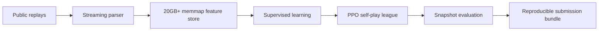

# Orbit Wars Agent

[日本語](#日本語) | [English](#english)

## 日本語

### 結果

Kaggle Game Arenaの戦略ゲームコンペティション「Orbit Wars」に個人で参加し、**4,729チーム中46位（上位約1.0%、Silver Medal）**を記録しました。

Orbit Warsは、2人または4人のagentが宇宙空間で艦隊を発射し、中立・相手の惑星を占領するゲームです。惑星は太陽の周囲を公転し、艦隊は直線移動するため、現在の距離だけでなく、到着時点の惑星位置、飛行中の艦隊、戦闘結果、太陽・惑星・彗星との衝突を考慮する必要があります。

私はreplay parser、教師あり学習dataset、Transformer policy/value network、forward simulator、PPO self-play league、評価・提出pipelineを一人で開発しました。

### システム概要



### 技術的に注力した点

#### 1. 艦隊一覧ではなく、惑星ごとの未来状態を入力する

初期モデルは飛行中の艦隊情報を持たず、周囲の中立惑星を数個占領した後に攻撃を止めることがありました。可変長の艦隊一覧をそのまま入力する案も検討しましたが、意思決定に必要なのは艦隊そのものより、到着後に各惑星の所有者と兵力がどう変わるかだと判断しました。

そこで、飛行中の艦隊の移動・到着・戦闘を`forecast.py`でforward simulationし、各惑星の将来の所有者、兵力、位置を固定長時系列へ変換しました。予測範囲を長くするとfeature storeも比例して大きくなるため、replayの移動時間分布を分析し、`HORIZON=20`を選択しています。

現在のOrbitNetは、惑星間関係をTransformer Encoderで表現し、発射有無、target、投入mode（最小占領兵力 / all-in）、state valueを予測します。必要兵力と衝突を避ける発射角は、学習モデルではなく同じforward simulatorと決定論的heuristicで計算します。関係学習はmodelに任せつつ、ゲーム規則上正確であるべき計算は検証可能なcodeへ分離しました。

#### 2. 20GBを超えるreplay featureを反復生成できるpipeline

公開replayのzipを展開せず、episode単位でstreaming parseします。featureはkeyごとのappend-only binary fileへ書き出し、学習時は`numpy.memmap`で必要なrowだけを読みます。所有者channelは`int8`で保存し、peak memoryをほぼ1 replay分に抑えました。

replay変換はProcessPoolで並列化し、parser・feature定義を変更すると`PARSER_VERSION`により古いcacheを自動無効化します。これにより、20GBを超えるfeatureをRAMへ一括展開せず、仕様変更後も同じ手順でdatasetを再生成できます。

#### 3. PPO self-playと退行を検出するsnapshot league

公開replayを用いた教師あり学習から開始し、そのweightを初期値としてPPO self-playへ移行しました。leagueは最大6個のbest snapshotと固定SL teacherを保持し、2人戦・4人戦のopponentをuniformにsampleします。training codeはteacher KL、GAE、resume時のoptimizer/RNG復元にも対応しています。

新しいsnapshotは直近snapshotへの評価を通過した後、最古のsnapshotに対する別の評価も通過した場合だけ保存します。これにより、特定の相手にだけ強くなる改善や、過去戦略への退行を検出します。

#### 4. Desktop learnerとMacBook actorによる分散rollout

1 gameずつ実行した初期構成では、rollout生成に約23.5秒かかりました。ProcessPoolによる並列化後は約2秒まで短縮しました。さらに、desktopでPPO learnerとlocal workerを動かし、MacBookではCPU worker poolを持つrollout serverを常駐させました。

remote構成ではtaskを標準でlocal 35% / remote 65%へ分け、完了した結果をqueueへ統合します。messageはlength-prefixed TCP上でzlib圧縮pickleとして送信し、snapshot weightはIDごとにserver側cacheへ同期して、同じweightの再送を避けます。

#### 5. 学習codeと提出物の不一致を防止

Kaggle提出は複数moduleとweightを1つのtar.gzへまとめる必要があります。提出scriptは毎回staging directoryを作り直し、実際にbundleへ入るcodeとweightでlocal sanity gameを実行できます。古い`model.py`と新しいcheckpointが混ざる事故を防ぐため、学習側と提出側で同じsourceを使用します。

### Repository layout

| Path | Role |
|---|---|
| `features.py` | Current state + 20-turn future trajectory features |
| `forecast.py` | Fleet movement, arrival, combat, aiming, and minimum-capture simulation |
| `model.py` | OrbitNet policy/value network |
| `replay.py` | Replay/action alignment and supervised labels |
| `dataset.py` | Streaming parser and disk-backed memmap dataset |
| `training/train_sl.py` | Supervised learning |
| `training/train_rl_v2.py` | PPO self-play and snapshot evaluation |
| `training/rollout_server.py` | Remote CPU rollout actor |
| `run_game.py` | Local 2-player/4-player evaluation and replay output |
| `submit_sl.sh`, `submit_rl.sh` | Reproducible Kaggle bundle creation |
| `latest_submission/` | Final staged agent source |

### 環境構築と実行

```bash
conda create -n orbit python=3.12
conda activate orbit
pip install -r requirements.txt

# 1. replay -> disk-backed feature store
python dataset.py --workers 8

# 2. supervised learning
python training/train_sl.py

# 3. PPO self-play
python training/train_rl_v2.py --iters 200 --games 8 --workers 6
```

複数gameのlocal evaluation:

```bash
python run_game.py --games 40 --workers 8 main.py random
python run_game.py main.py main.py main.py main.py
```

MacBookをremote actorとして使う場合:

```bash
# MacBook
python training/rollout_server.py --port 5555 --workers 6

# Desktop learner
python training/train_rl_v2.py --remote <mac-ip>:5555 --iters 200 --games 20
```

Kaggle bundle:

```bash
./submit_sl.sh "SL agent" --check
./submit_rl.sh "RL agent"
```

---

## English

### Result and problem

This repository contains my solo entry for Kaggle Game Arena: Orbit Wars. It placed **46th out of 4,729 teams (top ~1.0%, Silver Medal)**.

In Orbit Wars, two or four agents launch fleets to capture neutral and enemy planets. Planets orbit the sun while fleets move along straight trajectories, so an agent must reason about future planet positions, fleets already in flight, combat, and collision geometry—not only current distance.

I built the replay parser, supervised dataset, Transformer policy/value model, forward simulator, PPO self-play league, evaluation tooling, distributed rollout path, and submission pipeline.

### Design highlights

#### Future state per planet

An early model without in-flight fleet information captured a few nearby planets and then stopped expanding. Instead of feeding a variable-length fleet list directly to the network, the pipeline forward-simulates movement, arrival, and combat. Each planet receives a fixed 20-turn trajectory of future owner, garrison, and position.

OrbitNet uses a Transformer Encoder across planets and predicts launch gate, target, amount mode, and state value. Exact fleet sizing and collision-safe aiming remain in deterministic simulation and heuristics. This separates relational decisions that benefit from learning from calculations that must remain faithful to the game rules.

#### Disk-backed replay pipeline

Replay ZIP files are parsed one episode at a time without extraction. Features are streamed to append-only files and reopened through `numpy.memmap`; ownership channels are stored as `int8`. Process workers parse episodes in parallel, and `PARSER_VERSION` invalidates stale caches when replay or feature semantics change. The resulting 20GB+ store does not have to fit in RAM.

#### PPO league and regression gates

Training starts from supervised weights and continues with PPO self-play. The league keeps up to six best snapshots plus a fixed supervised teacher. Candidate snapshots are evaluated against the most recent checkpoint and, after that gate passes, against the oldest retained checkpoint to catch regression. The training path also supports GAE, teacher KL, and full optimizer/RNG resume bundles.

#### Distributed rollout

Parallel game workers reduced rollout time from roughly 23.5 seconds per game to about 2 seconds. A desktop learner can split work between its local pool (35%) and a persistent MacBook CPU actor (65%). Length-prefixed TCP messages carry zlib-compressed pickle payloads, and the remote server caches opponent snapshots by ID to avoid repeatedly sending the same weights.

#### Reproducible submission

Submission scripts rebuild a clean staging directory from the current source and weights before creating the Kaggle tarball. An optional sanity game runs the exact staged code, preventing stale modules and incompatible checkpoints from being submitted together.

### Quick start

```bash
conda create -n orbit python=3.12
conda activate orbit
pip install -r requirements.txt

python dataset.py --workers 8
python training/train_sl.py
python training/train_rl_v2.py --iters 200 --games 8 --workers 6
```

See the Japanese section above for the architecture, repository map, distributed actor commands, and submission workflow.
