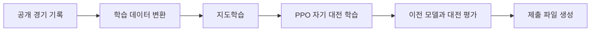

# Orbit Wars 게임 AI

함대를 보내 행성을 점령하는 전략 게임을 스스로 플레이하는 AI를 개발했습니다.
공개 경기 기록으로 기본 행동을 학습하고, 이전 버전의 AI들과 대전하며 전략을 학습하는 구조를 만들었습니다.

**Kaggle Orbit Wars 최종 46위 / 4,729팀 · 상위 약 1.0% · 은메달**

| 항목 | 내용 |
| --- | --- |
| 개발 기간 | 2026.06 — 기능 개발 커밋 기준 6월 9일~24일 |
| 참가 형태 | 개인 참가 |
| 담당 범위 | 학습 데이터 처리, 모델·시뮬레이터 구현, 지도학습·강화학습, 대전 평가, 제출 파일 구성 |
| 주요 기술 | Python, PyTorch, NumPy, Transformer, PPO, 멀티프로세싱 |

[대회 소개와 결과](https://www.kaggle.com/competitions/orbit-wars)

## 어떤 문제를 푸는 게임인가요?

두 명 또는 네 명의 플레이어가 행성에서 함대를 발사해 다른 행성을 점령하는 게임입니다.
행성은 태양 주위를 움직이고 함대는 직선으로 이동합니다. 현재 위치뿐 아니라 함대가 도착할 시점의 행성 위치와 전투 결과를 고려해야 합니다.

AI는 게임 상태를 입력받아 함대를 보낼지, 어느 행성을 공격할지, 얼마만큼의 함대를 보낼지 결정합니다.

## 구현한 학습 흐름



- **지도학습:** 상위 플레이어의 경기 기록에서 상태와 행동을 추출해 기본적인 플레이를 학습했습니다.
- **강화학습:** 지도학습한 모델을 초기 모델로 사용하고, 이전 버전의 모델들과 대전하며 PPO 방식으로 학습했습니다.
- **게임 시뮬레이션:** 함대 이동, 도착과 전투를 계산해 모델이 사용할 미래 상태를 만들었습니다.
- **실험 환경:** 데이터 변환, 대전 실행, 모델 평가와 제출 파일 생성을 반복할 수 있도록 구성했습니다.

## 주요 고민과 구현

### 1. 움직이는 행성과 함대를 어떻게 입력할 것인가

현재 거리만으로 공격을 판단하면 이미 이동 중인 함대가 도착한 뒤의 상황을 놓칠 수 있습니다.
이를 반영하기 위해 행성별로 향후 20턴의 소유자, 병력과 위치를 계산해 모델에 입력했습니다.
이 예측은 현재 확인된 함대를 바탕으로 하며, 상대가 앞으로 내릴 명령을 미리 아는 것은 아닙니다.

모델은 Transformer로 행성 사이의 관계를 처리하고, 발사 여부·공격 대상·투입 방식과 현재 상태의 가치를 예측합니다.
점령에 필요한 최소 함대 수와 충돌을 피하는 발사 각도는 시뮬레이터와 규칙으로 계산하도록 역할을 나누었습니다.

관련 코드: [미래 상태 계산](forecast.py) · [입력 구성](features.py) · [모델](model.py)

### 2. 20GB가 넘는 학습 데이터를 어떻게 처리할 것인가

공개 경기 기록을 학습 입력으로 변환하면 데이터가 커지므로, 전체 데이터를 한꺼번에 메모리에 올리지 않도록 구성했습니다.
경기 기록을 하나씩 읽어 변환한 데이터를 파일에 저장하고, 학습할 때는 `numpy.memmap`으로 필요한 부분을 읽습니다.
소유자 정보처럼 값의 범위가 작은 데이터는 작은 정수형으로 저장하고, 데이터 변환은 여러 프로세스로 나누어 실행했습니다.

입력 정의가 바뀌면 기존 캐시를 무효화해 이전 형식의 데이터를 다시 사용하는 문제도 방지했습니다.

관련 코드: [데이터 변환과 읽기](dataset.py) · [경기 기록 해석](replay.py)

### 3. 새 모델이 실제로 나아졌는지 어떻게 판단할 것인가

특정 상대에게 이기는 것만으로 전반적인 개선을 판단하기는 어렵습니다.
여러 과거 모델을 보관하고 새 모델의 대전 결과를 비교하도록 구성했습니다.
최근 모델에 대한 평가와 오래된 모델에 대한 평가를 함께 사용해, 새 전략을 학습하면서 이전에 잘하던 플레이를 잃는지도 살폈습니다.

관련 코드: [지도학습](training/train_sl.py) · [PPO 학습과 평가](training/train_rl_v2.py)

### 4. 반복 실험과 제출 과정을 어떻게 관리할 것인가

여러 경기를 병렬로 실행해 학습에 필요한 대전 기록을 수집했습니다.
데스크톱에서 모델을 학습하면서 다른 컴퓨터의 작업 프로세스가 경기를 실행하고 결과를 전달하는 분산 실행 경로도 구현했습니다.

제출할 때는 현재 코드와 모델 가중치를 별도 폴더에 모아 압축합니다.
지도학습 모델용 제출 스크립트에는 제출 폴더의 코드로 대전을 실행하는 선택 기능을 두어 코드와 가중치를 함께 확인할 수 있도록 했습니다.

관련 코드: [분산 경기 실행](training/rollout_server.py) · [대전 실행](run_game.py) · [제출 스크립트](submit_rl.sh)

## 결과와 돌아본 점

최종 순위는 4,729팀 중 46위이며 은메달을 받았습니다.
모델 구조뿐 아니라 게임 상태를 입력으로 표현하는 방법, 학습 데이터 처리와 평가 환경이 함께 필요하다는 점을 경험했습니다.

대전 상대와 초기 조건에 따라 승률이 달라질 수 있어, 한 번의 승률이나 제출 점수만으로 변경을 평가하지 않도록 주의했습니다.

## 주요 파일

| 파일 | 역할 |
| --- | --- |
| [features.py](features.py) | 현재 상태와 향후 20턴의 예측 상태를 모델 입력으로 구성 |
| [forecast.py](forecast.py) | 함대 이동·도착·전투와 발사 각도 계산 |
| [model.py](model.py) | 행동과 상태 가치를 예측하는 모델 |
| [dataset.py](dataset.py) | 경기 기록 변환과 파일 기반 학습 데이터 처리 |
| [training/](training/) | 지도학습, 강화학습과 분산 대전 실행 |
| [run_game.py](run_game.py) | 로컬 대전과 평가 |
| [latest_submission/](latest_submission/) | 제출용으로 구성한 코드와 가중치 |

## 실행 방법

기존 개발 환경은 Python 3.12입니다. 패키지 목록은 [requirements.txt](requirements.txt)에 정리했습니다.
학습에는 경기 기록 데이터가 필요하며, 제출과 경기 기록 다운로드에는 Kaggle 계정 설정이 필요합니다.
GPU를 사용한다면 실행 환경에 맞는 PyTorch를 설치해야 합니다.

```bash
conda create -n orbit python=3.12
conda activate orbit
pip install -r requirements.txt
```

데이터 변환과 학습:

```bash
python dataset.py --workers 8
python training/train_sl.py
python training/train_rl_v2.py --iters 200 --games 8 --workers 6
```

로컬 대전:

```bash
python run_game.py --games 40 --workers 8 main.py random
```

위 명령은 여러 경기의 승률을 집계합니다. 경기 기록과 HTML 리플레이를 저장하려면 `--workers 1`로 실행합니다.

Kaggle 제출(Bash 환경, Kaggle 계정 설정 필요):

```bash
bash submit_rl.sh "PPO 모델"
```

위 스크립트는 제출 파일을 만들고 Kaggle에 업로드합니다. 지도학습 모델은 `bash submit_sl.sh "지도학습 모델" --check`로 제출 폴더의 코드로 대전을 실행한 뒤 업로드할 수 있습니다.
